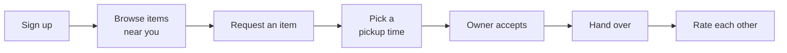

<div align="center">

# CampusSwap

**Pass it on, on campus.**

A campus-only app where students give away, swap or sell dorm items, and agree on pickup in the app.

[](https://escalopa.github.io/campusswap/)
[](https://github.com/escalopa/campusswap/actions/workflows/bot-tests.yml)
[](LICENSE)

[Documentation](https://escalopa.github.io/campusswap/) · [Presentation](https://docs.google.com/presentation/d/118UVpU_nEm3OP0KZgbS7O5V0DsFyDCYGhPjINbZ9dK4/edit?usp=sharing) · [Prototype](https://www.figma.com/proto/FBkfowqM4rI8lcgZ8fuzQv/CampusSwap?node-id=10-144&starting-point-node-id=10-144) · [Figma design](https://www.figma.com/design/FBkfowqM4rI8lcgZ8fuzQv) · [Project guide (PDF)](docs/assets/campusswap-project-guide.pdf)

</div>

---

## About

Every semester, students moving out of the dorms throw away usable items while newcomers buy the same things new. Telegram flea-market chats and Avito make passing items on slow: posts get buried, strangers feel risky, and arranging pickup takes many messages.

CampusSwap fixes this with a verified, campus-only audience, searchable listings, and pickup time and place built into every exchange.

This repository is the course project for **UX/UI for Startups** and contains:

- **The UX/UI case study:** research, lo-fi and hi-fi design, presentation
- **A working Telegram bot** (Python) that implements the core flows for a real campus pilot
- **Documentation** published with GitHub Pages

## Project links

| | Link |
|---|---|
| 📚 Documentation site | <https://escalopa.github.io/campusswap/> |
| 🎨 Figma design file | <https://www.figma.com/design/FBkfowqM4rI8lcgZ8fuzQv> |
| 📱 Clickable prototype | <https://www.figma.com/proto/FBkfowqM4rI8lcgZ8fuzQv/CampusSwap?node-id=10-144&starting-point-node-id=10-144> |
| 📊 Case study presentation | [Google Slides](https://docs.google.com/presentation/d/118UVpU_nEm3OP0KZgbS7O5V0DsFyDCYGhPjINbZ9dK4/edit?usp=sharing) · [PowerPoint version](docs/assets/campusswap-case-study.pptx) |
| 🤖 Telegram bot | Prod <https://t.me/campusswap_bot> · Test <https://t.me/campusswap_test_bot> |
| 📝 Research forms | Created by [`research/forms`](research/forms/create_research_workspace.gs); links in the research spreadsheet |
| 📄 Project guide (PDF) | [docs/assets/campusswap-project-guide.pdf](docs/assets/campusswap-project-guide.pdf) |
| 📄 Research plan (PDF) | [docs/assets/campusswap-research-plan.pdf](docs/assets/campusswap-research-plan.pdf) |

## The product



**MVP features:** verified sign-up · post an item in 30 seconds · search and categories · filter by dorm building · free, swap or sell · quick-reply chat · pickup time and place scheduler.

Read more: [product overview](https://escalopa.github.io/campusswap/product/), [research](https://escalopa.github.io/campusswap/product/research/), [design](https://escalopa.github.io/campusswap/product/design/).

## Telegram bot

```bash
cd bot
python3 -m venv .venv && source .venv/bin/activate
pip install -e .
cp config.example.toml config.toml   # then paste your token from @BotFather
python -m campusswap_bot --config config.toml
```

See [Run the bot locally](https://escalopa.github.io/campusswap/bot/setup/), [Deploy to Google Cloud](https://escalopa.github.io/campusswap/bot/deploy/) (Cloud Run + Firestore) and [Architecture](https://escalopa.github.io/campusswap/bot/architecture/) for how it works.

## Repository structure

```text
.
├── bot/                    # Telegram bot (Python, python-telegram-bot, SQLite)
│   ├── campusswap_bot/     # source code
│   ├── tests/              # pytest suite
│   └── config.example.toml # copy to config.toml (git-ignored)
├── research/               # Google Forms script and survey analysis
├── docs/                   # documentation site (MkDocs Material)
│   ├── assets/             # PDFs and the presentation
│   ├── product/            # problem, research, design, roadmap
│   ├── concepts/           # UX/UI and tech glossaries
│   ├── bot/                # bot setup, user guide, architecture
│   └── course/             # course requirements and exam prep
├── mkdocs.yml
└── .github/workflows/      # docs deployment and bot tests
```

## Build the docs locally

```bash
python3 -m venv .venv && source .venv/bin/activate
pip install -r docs/requirements.txt
mkdocs serve   # http://127.0.0.1:8000
```

## Status

Research materials, the lo-fi prototype, the style guide, the pattern library and the Telegram bot MVP are done. The 7 hi-fi screens and the clickable prototype are done. Interviews and usability tests are in progress. See the [roadmap](https://escalopa.github.io/campusswap/product/roadmap/).

## Author

**Ahmed Helaly** — UX research, UX/UI design, development.

## License

[MIT](LICENSE)
