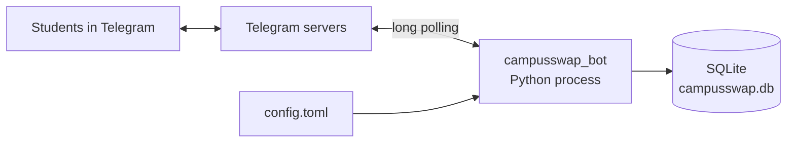
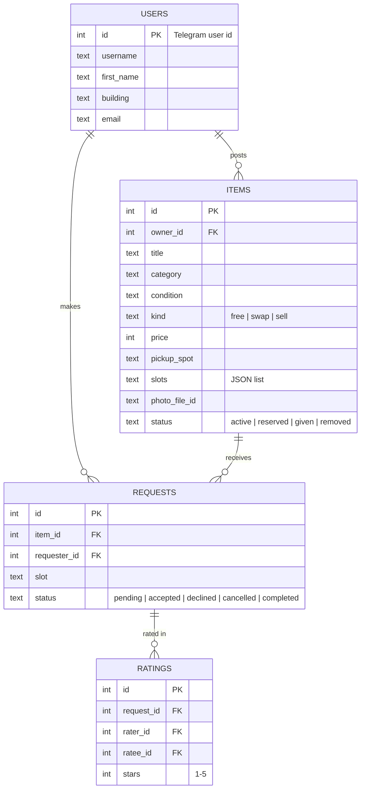
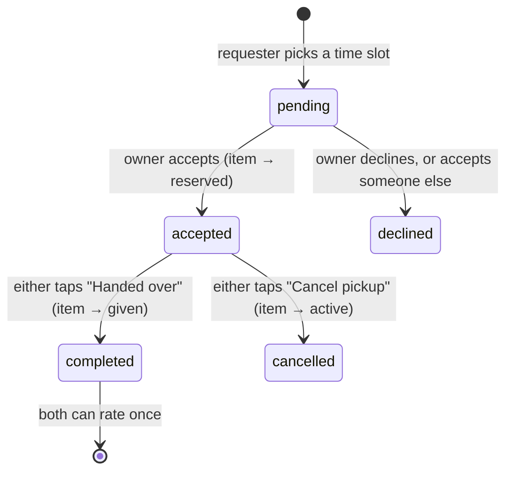
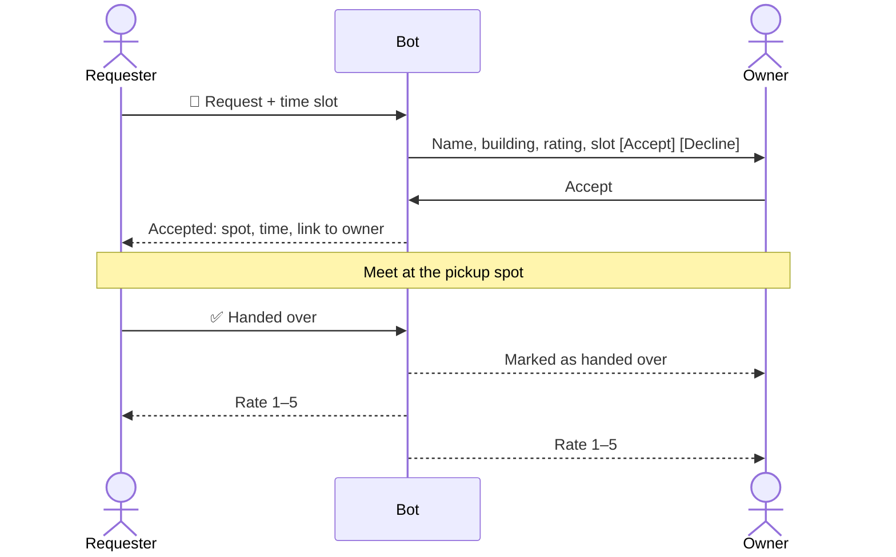

# Architecture

A small, single-process Python app: [python-telegram-bot](https://python-telegram-bot.org/) for Telegram, SQLite for storage, a TOML file for configuration.



## Code layout

```text
bot/
├── campusswap_bot/
│   ├── __main__.py      # CLI entry point: python -m campusswap_bot --config config.toml
│   ├── app.py           # builds the Application, registers handlers, error handler, bot commands
│   ├── config.py        # loads and validates config.toml
│   ├── db.py            # SQLite schema and data access (users, items, requests, ratings)
│   ├── keyboards.py     # inline and reply keyboards
│   ├── texts.py         # message texts and pure helpers (parsing, formatting, validation)
│   └── handlers/
│       ├── common.py     # shared helpers: db/config access, "must /start first" guard
│       ├── onboarding.py # /start conversation (email, building), /building
│       ├── post.py       # "post an item" conversation
│       ├── browse.py     # browsing cards and filters
│       ├── exchange.py   # request → accept/decline → handover → rating
│       └── account.py    # my items, my requests, profile, help
├── tests/               # pytest: config, database, texts, app wiring
├── config.example.toml
└── pyproject.toml
```

Handlers are registered in two groups. Group 0 holds the two conversations (onboarding, posting). Group 1 holds menu buttons, browsing and exchange buttons. Pressing a menu button in the middle of posting cancels the post and still opens that menu.

## Data model



## Exchange lifecycle





## Design decisions

| Decision | Why |
|---|---|
| Long polling, not webhooks | Runs on any laptop without a public URL or server |
| SQLite | Zero setup, one file, enough for a campus pilot |
| TOML config file | Readable, built into Python 3.11 (`tomllib`), keeps the token out of the code |
| Store Telegram `file_id`, not images | Telegram hosts the photos; no storage needed |
| Email check is format-only | Real verification needs an email service; listed on the roadmap |
| HTML messages with escaping | All user text is escaped, so titles like `<b>` can't break formatting |
| httpx logs silenced | Request URLs contain the bot token; this keeps it out of the logs |

## Roadmap

- "Wanted" requests: get notified when someone posts what you need
- Email verification with a one-time code
- Report and block users
- Admin commands for moderators
- Hosting on Google Cloud Run (webhook mode) with Cloud SQL
