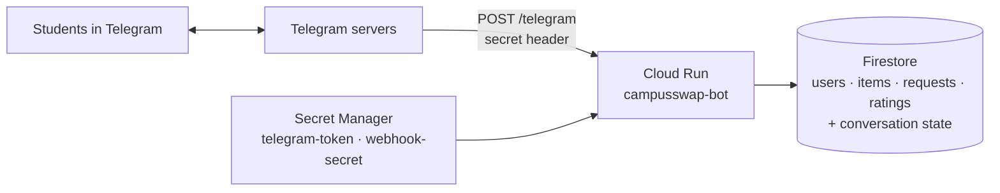

# Deploy to Google Cloud

The bot runs on **Cloud Run** in webhook mode with **Firestore** as its database, in the `campusswap-infra` project (region `europe-west1`). It scales to zero when nobody is using it, so at pilot scale it stays within the free tier.



## How it differs from running locally

| | Local | Cloud Run |
|---|---|---|
| Updates | Long polling | Webhook (`POST /telegram`) |
| Storage | SQLite file | Firestore (`[storage].backend = "firestore"`) |
| Conversation state | Memory | Firestore (`FirestorePersistence`), so a half-finished post survives a restart |
| Secrets | `config.toml` | Secret Manager → `CAMPUSSWAP_TOKEN`, `CAMPUSSWAP_WEBHOOK_SECRET` |
| Entry point | `python -m campusswap_bot` | `python -m campusswap_bot.server` (Dockerfile) |

The service runs with `--max-instances 1`, so one instance owns the in-memory conversation state, and processes each update inside the HTTP request, so CPU is only billed while a message is handled. The webhook secret travels only in Telegram's `X-Telegram-Bot-Api-Secret-Token` header, never in the URL or logs.

## One-time setup (already done for `campusswap-infra`)

```bash
P=campusswap-infra
gcloud projects create $P
gcloud billing projects link $P --billing-account=<BILLING_ACCOUNT_ID>
gcloud services enable run.googleapis.com firestore.googleapis.com secretmanager.googleapis.com \
  artifactregistry.googleapis.com cloudbuild.googleapis.com --project $P
gcloud firestore databases create --project $P --location=europe-west1
gcloud firestore databases create --project $P --database=test --location=europe-west1   # for tests

gcloud iam service-accounts create campusswap-bot --project $P
gcloud projects add-iam-policy-binding $P --role roles/datastore.user \
  --member serviceAccount:campusswap-bot@$P.iam.gserviceaccount.com

# Secrets (values are piped in, never typed on the command line)
python -c "import tomllib;print(tomllib.load(open('config.toml','rb'))['telegram']['token'],end='')" \
  | gcloud secrets create telegram-token --project $P --data-file=-
python -c "import secrets;print(secrets.token_urlsafe(32),end='')" \
  | gcloud secrets create webhook-secret --project $P --data-file=-
for s in telegram-token webhook-secret; do
  gcloud secrets add-iam-policy-binding $s --project $P --role roles/secretmanager.secretAccessor \
    --member serviceAccount:campusswap-bot@$P.iam.gserviceaccount.com
done
```

## Deploy

From the `bot/` folder, with the virtual environment set up:

```bash
./deploy/deploy.sh
```

It builds the image with Cloud Build, deploys the `campusswap-bot` service, and registers the webhook with Telegram.

!!! warning "Webhook vs local polling"
    While the webhook is set, `python -m campusswap_bot` (polling) cannot receive updates. To develop locally again:
    `python -m campusswap_bot --config config.toml --delete-webhook`, and run `./deploy/deploy.sh` afterwards to switch back.

## Operate

```bash
# Logs
gcloud run services logs read campusswap-bot --project campusswap-infra --region europe-west1 --limit 50
# Is Telegram reaching us?
python -c "import asyncio,tomllib;from telegram import Bot;t=tomllib.load(open('config.toml','rb'))['telegram']['token'];print(asyncio.run(Bot(t).get_webhook_info()))"
```

Data lives in the Firestore console under `campusswap-infra` → Firestore → `(default)`.

## Tests against Firestore

```bash
CAMPUSSWAP_FIRESTORE_TEST_PROJECT=campusswap-infra CAMPUSSWAP_FIRESTORE_TEST_DATABASE=test pytest
```

Every database and flow test then runs twice (SQLite and Firestore), plus a test that restarts the app in the middle of posting an item and checks the post can still be finished. Each test writes under its own collection prefix and cleans up.
