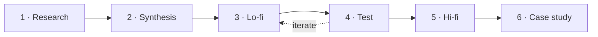

# The UX process

A UX project moves from **understanding people** to **designing**, **testing** and **polishing**. Each step uses what the previous step found, which is why the order matters.

| Step | What you do | What it produces | In CampusSwap |
|---|---|---|---|
| **1. Research** | Talk to real users (interviews), ask many users (survey), look at what already exists | Research plan, notes, survey results, competitive analysis, report | [Research](../product/research.md) |
| **2. Synthesis** | Group what you heard into themes, turn them into ideas, pick the most valuable | Affinity map, HMW questions, feature ideas, prioritization matrix | Lo-Fi section A.1–A.4 |
| **3. Lo-fi** | Sketch on paper, then build rough grey screens | User flow, Crazy 8s, wireframes, lo-fi prototype | Lo-Fi section B.1–B.3 |
| **4. Test** | Watch 2–5 people try the prototype and note where they struggle | Usability findings, user flow v2.0 | Hi-Fi section A.2–A.3 |
| **5. Hi-fi** | Apply colors, fonts, icons and real content; make it clickable | Moodboard, style guide, pattern library, hi-fi screens, prototype link | Hi-Fi section B.1–B.4 |
| **6. Case study** | Tell the story from problem to results and learnings | Presentation and live demo | Case study deck |

## Why this order

- **Research before design:** designing first means designing for your own assumptions, not for users.
- **Lo-fi before hi-fi:** grey boxes are cheap to change. Testers comment on the flow instead of the colors.
- **Test before polishing:** a beautiful screen that people can't use still fails.
- **Iterate:** testing usually sends you back to the lo-fi step at least once. That's expected, and it's a good thing to show in a case study.

## Related frameworks

- **Design thinking:** empathize → define → ideate → prototype → test. The same idea with different names.
- **Double diamond:** *discover* and *define* the right problem (first diamond), then *develop* and *deliver* the right solution (second diamond). Each diamond opens up (many options) and then narrows down (one choice).
- **Lean UX:** build the smallest thing that tests an assumption, learn from real use, repeat. The [Telegram bot](../bot/index.md) is a Lean UX experiment.
- **Design sprint:** a five-day version of the whole process (understand, sketch, decide, prototype, test).
