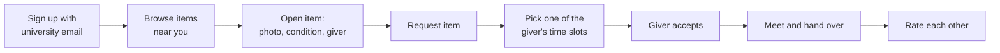

# Product overview

## The problem

Every semester, students move into and out of the university dorms. Students leaving throw away usable items: kettles, desk lamps, hangers, textbooks, mattress toppers, sports gear. At the same time, newcomers buy the same items new.

Today these exchanges happen in Telegram flea-market chats, on general marketplaces like Avito, or by word of mouth. We started with three assumptions about why that doesn't work well:

| Assumed pain point | Why it hurts |
|---|---|
| **Posts get buried** | Listings in busy chats scroll away within hours and can't be searched or filtered. |
| **Strangers feel risky** | There's no way to know if the other person is a real student or will show up. |
| **Pickup takes many messages** | Agreeing on a time and place between dorm buildings is a long back-and-forth. |

!!! note
    These are starting assumptions. The [user research](research.md) is designed to confirm or change them.

## The idea

> **CampusSwap helps students pass on dorm items to each other, free or cheap, in a few taps, with verified students and built-in pickup.**

### Value proposition

For **university students living in dorms**
who **need everyday items or want to get rid of them**,
CampusSwap is a **campus-only exchange app**
that lets them **find, give away and pick up items from verified students nearby**.
Unlike Telegram flea-market chats and Avito,
**listings are searchable, stay visible, come only from fellow students, and include a pickup time and place.**

## Who it's for

| User | Goal | Typical moment |
|---|---|---|
| **The giver** | Get rid of things quickly, ideally to someone who needs them | Moving out at the end of a semester |
| **The getter** | Get dorm essentials cheap or free, close by | Moving in, or when something breaks |

## MVP features

The minimum viable product (MVP) was chosen with a [value vs complexity matrix](research.md#synthesis-from-notes-to-features) from 15 ideas.

| # | Feature | Why it's in the MVP |
|---|---|---|
| 1 | Verified university sign-up | Trust: only real students |
| 2 | Post an item in 30 seconds | Posting must be faster than writing a chat message |
| 3 | Search and categories | Fixes "posts get buried" |
| 4 | Filter by dorm building | Nearby items mean easy pickup |
| 5 | Free, swap or sell | Matches how students already exchange |
| 6 | Quick-reply chat | Less typing to agree |
| 7 | Pickup time and place scheduler | Fixes "pickup takes many messages" |

Later ideas: "wanted" alerts, ratings and reviews, handover QR code, move-out bulk listing, eco impact counter. The [Telegram bot](../bot/index.md) already includes ratings and a simple eco counter.

## How it works

## Competitive landscape

| | Telegram dorm chats | Avito | VK groups | Free shelf | **CampusSwap** |
|---|:---:|:---:|:---:|:---:|:---:|
| Campus-only audience | ✓ | ✗ | ~ | ✓ | **✓** |
| Search and categories | ✗ | ✓ | ~ | ✗ | **✓** |
| Posts stay visible | ✗ | ✓ | ~ | ✓ | **✓** |
| Verified students | ~ | ~ | ~ | ✗ | **✓** |
| Built-in pickup time and place | ✗ | ✗ | ✗ | ✗ | **✓** |
| Alerts for wanted items | ✗ | ✓ | ✗ | ✗ | later |

✓ supported · ~ partly · ✗ not supported. Desk research, October 2026.

**The gap:** Telegram chats have the right audience but the wrong format. Avito has the right format but the wrong audience.
