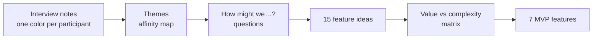

# Research

The full plan is in the [research plan PDF](../assets/campusswap-research-plan.pdf) and in the Figma file, section **01 · UX Research**.

## Goals

1. **Understand current behavior:** how students get rid of and get dorm items, and which channels they use.
2. **Find pain points:** what makes buying, selling or giving away items between students slow, frustrating or risky.
3. **Understand trust and handover:** what makes students trust another student, and what makes pickup easy or hard.

Out of scope: payments, delivery services, selling outside the university.

## Research questions

1. What items do students buy, sell or give away, and when (move-in, move-out, mid-semester)?
2. Which channels do they use today, and why?
3. What frustrates them most about these channels?
4. What information do they need before deciding to take an item?
5. What makes them trust or distrust another student?
6. How do they arrange the handover, and what goes wrong?
7. What motivates them to sell versus give items away for free?

## Methods

=== "Interviews (primary)"

    - **Who:** 5–6 dorm residents
    - **Format:** 20–30 minutes, semi-structured, in person or by call
    - **Guide:** introduction script, 14 questions (each with its rationale), wrap-up script
    - **Why:** depth — real stories about past exchanges, motivations and feelings

=== "Survey (validation)"

    - **Who:** 30+ dorm residents
    - **Format:** Google Forms, about 5 minutes, anonymous
    - **Questions:** 13, multiple choice, Likert scales, ranking and one open question
    - **Why:** shows how common each behavior and pain point is

=== "Competitive analysis (supporting)"

    - **What:** Telegram dorm chats, Avito, VK groups, campus free shelves
    - **Criteria:** campus-only audience, search, visibility, trust, pickup, alerts, fees
    - **Result:** see the [competitive landscape](index.md#competitive-landscape)

## Recruiting criteria

- **Must:** current student living in the dorms for at least one semester, who exchanged (or threw away) an item in the last 12 months
- **Mix:** 2+ mostly givers and 2+ mostly getters, different study years, at least one international and one local student
- **Exclude:** close friends and teammates (bias), anyone who has seen the concept

## Key findings

!!! warning "To fill after interviews"
    This section will hold 2–3 key findings, each with a supporting participant quote and how many participants or respondents said it, plus a recommendation per finding.

| # | Finding | Evidence | Recommendation |
|---|---|---|---|
| 1 | *pending* | *quote + count* | *pending* |
| 2 | *pending* | *quote + count* | *pending* |
| 3 | *pending* | *quote + count* | *pending* |

## Synthesis: from notes to features

Draft themes and their opportunity questions (to be confirmed by the real notes):

| Theme | How might we… |
|---|---|
| Finding items | …help students quickly find the item they need on campus? |
| Posting and reach | …make posting an item fast and keep it visible? |
| Trust and safety | …help students feel safe exchanging with someone they don't know? |
| Handover | …make agreeing on pickup time and place effortless? |
